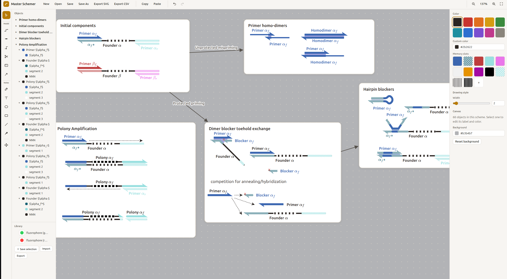
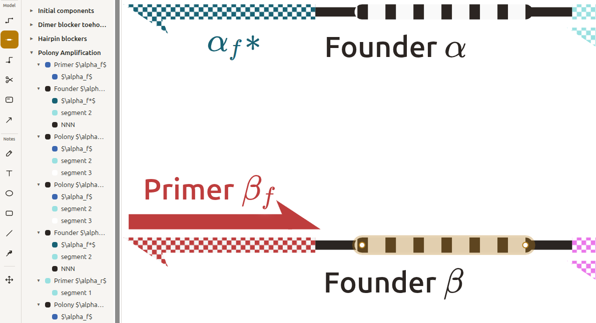
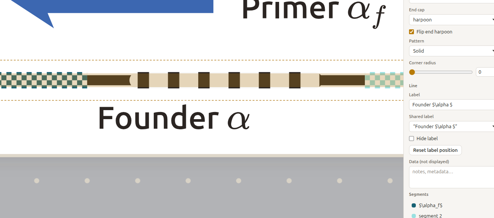
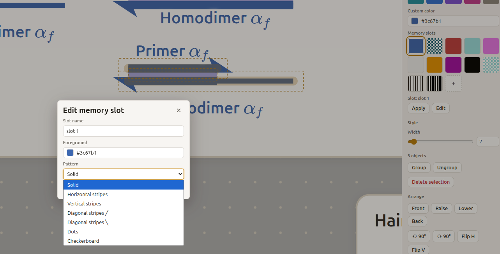
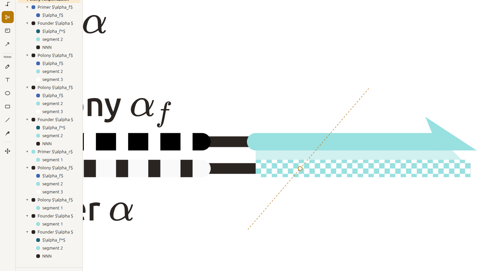
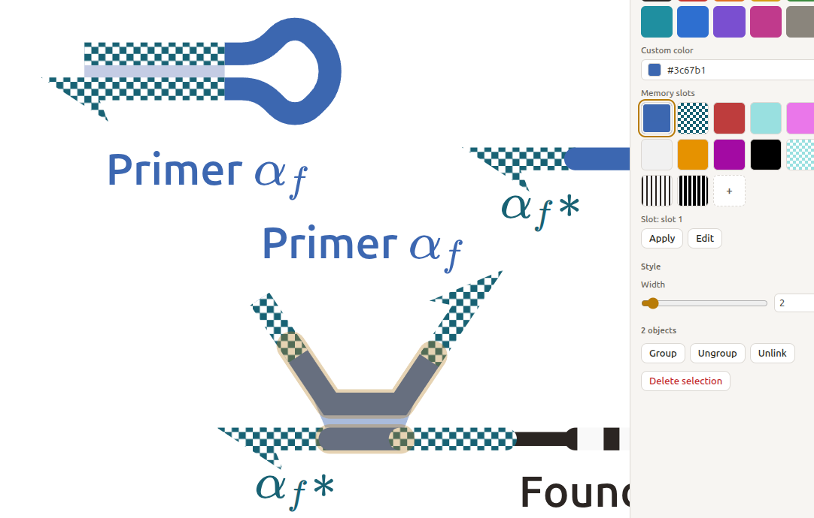

# Master Schemer

A lightweight semantic scheme editor — a drawing canvas where lines, segments,
cards, and arrows are tracked objects with labels and colors, not just ink.
Built for illustrating processes and relationships between objects: reaction
schemes, protocols, conceptual flows.



## Feature tour

### Segments: one line, many colored spans



A single line object carries any number of sub-segments, each with its own
color, pattern, width, and label. Press the Segment tool on a line and drag
along it to mark a span. It snaps to the half-grid, and a selected segment
shows draggable end dots. The Founder β strand above runs plain black through
most of its length, with checkered ends and a dotted tan core marking distinct
regions of the same strand.

### LaTeX in every label and note



Any label or note renders math through KaTeX, offline, with no network call.
Type `$\alpha_f$` in the label field and the canvas shows it typeset. The same
source exports into SVG with the KaTeX fonts written in as data URIs, so the
math still renders wherever the file ends up.

### Memory slots that propagate



A memory slot stores a color and an optional pattern (stripes, dots,
checkerboard). Select a slot and hit **Apply** to paint the current object from
it. Every object painted from a slot stays bound to it. Open **Edit** and the
popup changes color or pattern live, pushing each change out to all users of
that slot at once. Drag slots to reorder them. Remove one and its current look
freezes onto whatever was using it.

### Cut a line in two



The Cut tool (`X`) slices one line into two child objects. Drag a blade across
the canvas. The moment it crosses a line, a dot appears at the crossing and
slides as you move, marking where the cut will land. Release and the line
splits there. Both halves inherit the parent's color, width, label, segments,
group, and full pair of end caps. A cut only ever touches the first line the
blade meets, so one stroke
never shreds a whole diagram. Segments split at the cut as well: slice a span a
third of the way along and one child keeps that third, the other keeps the
rest.

### Links: the area between two objects



Select exactly two objects (or segments, or whole groups) and press **Link** to
fill the line-of-sight area between them. The fill tracks both ends and
reshapes as either moves, so a linked pair reads as one bound complex. Its
color and opacity are yours to set, and **Unlink** in the panel dissolves it.

### DNA molecules

Set a line's **Draw as** to **DNA molecule** (or tick **Draw as DNA molecules**
for a whole selection) and it renders as a space-filling B-DNA strand, baked
from the Blender library's B-DNA model. The brush works like an Affinity
Designer image brush: an end cap, a repeating one-turn body, and another end
cap, bent along the line. Segment colours carry over as domain colours. New
molecules start in toon shading with a black outline.

- **DNA grid.** The document has a DNA scale: *N bp per grid square*, by
  default 10 (one helical turn). Base counts follow the drawn length on that
  grid, and the diameter follows the scale, so anything you draw looks natural
  and its length tells you its base count. You can go off the grid two ways:
  type a **Diameter**, or type **Bases** and the molecule stretches or
  compresses to fit (the panel shows by how much). **Snap to DNA grid** puts a
  strand, its domains and its duplexes back on the grid.
- **Duplexes.** A **Base pairs** link between two DNA strands (or between two
  segments of one strand, for a hairpin) draws a double helix along the midline
  between them (linking two DNA strands makes one straight away), and each backbone takes its own strand's colour. The link's
  base-pair count sets that domain's length on both strands. Where a strand
  carries on single-stranded, it leaves the duplex in phase along its own
  backbone and then bends out to its line, so a partly hybridized pair reads as
  one molecule. Strands drawn half a grid apart give the smallest bend.
- **Nicks and domains.** Hold **Shift** while releasing the Cut tool to split
  just the domain under the blade: the strand stays whole and gains a domain
  boundary there. To nick one strand of a duplex, cut that strand normally,
  Shift-cut its partner at the same place, and pair each piece with its half.
- **Finding the strands.** A duplex hides its strands, so clicking it selects
  the duplex and shows both strands dashed. Click it again to select the strands
  themselves, or use the buttons in its panel.
- **Colouring a duplex.** A duplex has no colour of its own. Each backbone is
  its strand's paired segment (or whole line). With a duplex selected, a palette
  swatch recolours both backbones (or just one, while its picker is open), and
  the panel has a picker for each backbone
  plus the shading and colour-by controls for both strands.
- **Global switch.** **DNA** in the status bar (or View → DNA Molecules) draws
  every DNA strand as its plain line, and every duplex as base-pair rungs,
  without changing the document. Each line keeps its own Draw-as setting, so a
  scheme can mix molecules and plain lines. To convert many lines at once,
  select them (Ctrl+A works, other objects are ignored) and tick **Draw the
  lines as DNA molecules**.
- **Look.** **Shading** can be *Soft* (rendered) or *Toon* (flat bands), and
  **Black outline** is independent of colour. **Colour by** can be:
  - *Strand*.
  - *Backbone + bases*, with its own base colour.
  - *Sequence*: A green, C blue, G amber, T red. A segment whose **String** is a
    sequence shows that sequence; other bases are random, e.g. for a UMI.
    Paired bases show their partner's complement.

The textures live in `app/js/dna-tex.js`. They are regenerated with
`blender -b -P tools/bake_dna_brush.py`, which needs the Molecular Nodes
extension and the Blender asset library.

### Data and string fields

Every object carries a hidden **Data** field for notes and metadata that never
draws on the canvas. Toggle **Data** or **Data on hover** in the status bar to
reveal it. Segments add a **string** field that concatenates along the line, so
a strand of segments spells out a sequence read end to end. **Export CSV** dumps
every object (or just the selection) with its type, name, group, card, color,
string, and data, ready to drop into a spreadsheet.

## Model tools (tracked objects)

| Tool | Key | What it does |
|---|---|---|
| Select | `V` | Click to select, drag to move (multi-selections too), marquee on empty space, double-click to edit text. `Ctrl`+drag clones. Drag a line's end dot to keep laying down line. Drag a selected object's label to reposition it. Dragging a selected segment moves its whole line. Cards, rectangles, and ellipses show corner handles to resize. |
| Line | `L` | Drag to draw a snaking path — horizontal, vertical, and 45° runs at **half-grid** resolution; turns commit corners automatically. Start on an existing line's end to extend it. |
| Segment | `S` | Press on a line and drag along it to mark a colored, labelled sub-segment. Snaps at half-grid resolution; a selected segment's end dots are draggable. |
| Edit line | `E` | Click a line, then drag its square vertex handles to reshape the path. Click anywhere on the selected line to **insert a new vertex** there. |
| Cut | `X` | Drag a blade across a line to slice it into two. A sliding dot marks where the cut lands. Both halves inherit the parent's metadata, segments split at the cut, and any link on the line drops away. Hold Shift on release to split only the domain under the blade and keep the line whole. |
| Card | `C` | Drag to frame a section — a white sub-canvas card. Cards move by their border/corners only (so their contents stay clickable) and carry their contents with them. |
| Connect | `A` | Drag from one card to another to draw a labelled arrow between them. |

Select two lines whose ends meet on the same grid point and press **Join
lines** in the panel to fuse them into one object.

**Groups** (`Ctrl+G` / `Ctrl+Shift+G` or the panel buttons) bundle any
selection into a named group: clicking one member selects them all, the
sidebar nests members under the group's (renameable) name, and clones land in
a fresh group. Groups **nest** — group whole groups together into
supergroups, to any depth; ungrouping a supergroup releases it back into its
constituent subgroups rather than scattering everything.

**Links** join two selected objects (or segments, or two whole groups) into a
filled area spanning between them — select exactly two things and press
**Link** in the panel. The fill colour and opacity are yours to set, and the
shape re-flows automatically as either end moves. Between two lines or two
segments, set the link's **Style** to **Base pairs** to draw a hybridized
domain explicitly: enter how many **Bases** the domain has and that many
evenly spaced rungs are drawn across, pairing antiparallel strands end to end.

## Annotation tools (not tracked)

| Tool | Key | What it does |
|---|---|---|
| Freehand | `D` | Unsnapped ink for quick annotations. |
| Note | `T` | Click to place a text note — or **drag a box** to set the width the text wraps at. Wrap math in `$…$` for LaTeX (KaTeX, offline; labels support it too). |
| Ellipse | `O` | Drag to draw a circle/ellipse; hold **Shift** for a perfect circle. Fill it from the panel. |
| Rectangle | `B` | Drag to draw a rectangle; hold **Shift** for a square. Round its corners and fill it from the panel. |
| Free line | `N` | A straight line annotation. |
| Free arrow | `R` | Same, with an arrowhead. |
| Pan | `H` / Space / middle-drag | Move around the canvas. Mouse wheel zooms at the cursor. |

Shape and line annotations snap to the half-grid; toggle **Snap** in the
status bar to draw freely. Any annotation can be **promoted to a tracked
object** from the panel — it then appears in the object sidebar with the rest.

The status bar also carries **Data** (show every object's hidden data in a box
beside it) and **Data on hover** (reveal one object's data as you point at it).

## Sidebar, panel, palette

- The **Objects sidebar** lists every tracked object — user groups first,
  then grouped under the card that contains them; segments nest under their
  line. Click to select, double-click to rename (segments and groups too).
- The **Library** below it stores reusable assets across sessions: select
  something and hit **＋ Save selection**, click an asset to stamp a copy
  onto the canvas. **Export**/**Import** move the library between machines
  as a plain JSON file.
- The **properties panel** edits label, color, width (slider + numeric
  input), fill (for rectangles/ellipses), line style (solid/dashed/dotted),
  line ends (rounded/flat/square), end caps (arrow, **harpoon** — a
  seamless half-arrow you can flip to either side — barb, square, circle),
  rectangle corner radius, a hidden **Data** notes field per object, canvas
  **background colour** (when nothing is selected), and **Arrange**: z-order
  (Front/Raise/Lower/Back), rotate 90°/flip, and alignment
  (left/center/right/top/middle/bottom) for multi-selections.
- **Labels** can be hidden, dragged to a custom position, and **shared**:
  attach elements to a shared label slot and renaming one renames them all.
- **Color**: 10 fixed swatches, an inline hue/saturation picker with hex
  input, and **memory slots**. Objects colored from a slot stay linked to
  it — edit the slot and every user recolors instantly. Removing a slot
  freezes its current color into its users.
- Line width goes up to one full grid unit, so two adjacent lines tile the
  lattice with no gap.

`Ctrl+Z`/`Ctrl+Shift+Z` undo/redo, `Delete` removes, arrow keys nudge by one
grid cell, `Ctrl+G` groups, `1` fits the scheme in view, `0` resets zoom.

Documents autosave locally. **Save** / **Save As** (`Ctrl+S` /
`Ctrl+Shift+S`) write a `.schemer.json` file — through native file dialogs in
the desktop app — and **Open** loads one. **Export** (`Ctrl+E` for SVG,
`Ctrl+Shift+E` for PNG, or File → Export CSV) opens a dialog: pick the format
and file name, whether to export only the selection, show the grid or leave the
background transparent, and for PNG the resolution (1×–8×, with the pixel size
shown). **Export…** then opens the save dialog to choose where it goes; the
dialog remembers its settings and the last folder. **SVG** is a standalone
vector file; **CSV** dumps every object (or just the selection — a selected
card exports its contents) with its type, name, group, card, color, and hidden
data. Notes and labels using `$math$` render via KaTeX both
in-app and in exported SVGs — the export bakes the KaTeX stylesheet and fonts
in as data URIs, so the file renders math anywhere with nothing alongside it.

Each session opens on a fresh blank canvas (work is still autosaved locally
between edits; use **Open** to reload a saved `.schemer.json`).

## Running

No build step, no dependencies. Serve the folder and open it:

```bash
python3 -m http.server 8123   # then http://localhost:8123
```

(Any static server works; opening `index.html` directly also works in
browsers that allow ES modules from `file://`.)

## Desktop app (Linux / macOS / Windows)

The desktop build is a thin [Tauri](https://tauri.app) wrapper around the same
files. With Rust and the Tauri CLI installed:

```bash
cargo install tauri-cli --locked
cargo tauri build        # from the repo root; bundles for the host platform
```

Tagged releases (`v*`) build all three platforms automatically via GitHub
Actions — see `.github/workflows/release.yml`.

## Development

```bash
node --test test/geom.test.mjs test/cut.test.mjs   # geometry + cut unit tests
```

Source layout (vanilla ES modules, no framework):

- `js/geom.js` — grid snapping, 8-direction path logic, arc-length math, path merging
- `js/model.js` — document model, palette slots, selection, undo history, z-order, persistence
- `js/render.js` — SVG rendering (caps, dashes, KaTeX notes) + SVG export
- `js/tools.js` — tool state machines
- `js/app.js` — shell: event routing, sidebar, panel, keyboard, file ops
- `vendor/katex/` — vendored KaTeX for offline math

`PRODUCT.md` and `DESIGN.md` capture the product intent and visual system.
